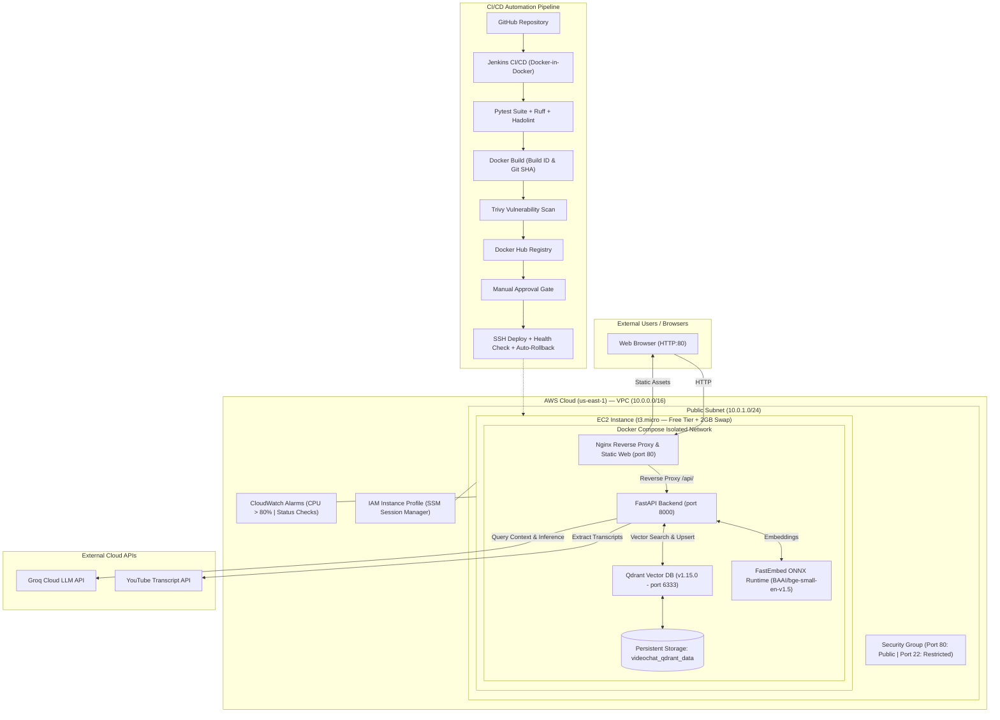

# VideoChat AI — Enterprise DevOps & Cloud Native RAG Platform

[](https://www.docker.com/)
[](https://www.terraform.io/)
[](https://aws.amazon.com/)
[](https://www.jenkins.io/)
[](https://trivy.dev/)
[](https://github.com/astral-sh/ruff)

VideoChat AI is a production-grade, containerized Video Q&A platform powered by Retrieval-Augmented Generation (RAG). Users input any YouTube video URL to automatically extract, chunk, and index transcripts into a high-performance vector database, enabling precise, context-aware conversations powered by Groq LLMs.

This repository features a complete, battle-tested DevOps engineering layer: multi-stage Docker builds, automated testing & linting gates, Terraform AWS infrastructure, declarative Jenkins CI/CD pipeline with Trivy container security scanning, and automated zero-downtime rollback scripts.

---

## Architecture



---

## Tech Stack Overview

| Category | Technologies | Description & Production Highlights |
| :--- | :--- | :--- |
| **Frontend** | React 19, Vite, Tailwind CSS, Lucide | Modern reactive dashboard; built via multi-stage Docker build served on Nginx Alpine runtime. |
| **Backend** | Python 3.11, FastAPI, Uvicorn | Async REST API running as unprivileged `appuser:appgroup`; auto-downloads embeddings at build time. |
| **Vector DB** | Qdrant `v1.15.0` | High-performance vector database with persisted Docker volume and custom TCP socket health checks. |
| **AI / RAG** | FastEmbed (`bge-small-en-v1.5`), Groq | Low-latency ONNX local vector embeddings coupled with Groq Cloud LLM inference. |
| **Containerization** | Docker, Docker Compose, Nginx | Multi-stage caching, non-root users, reverse proxy routing, internal bridge network isolation. |
| **Infrastructure** | Terraform (`>= 1.5.0`), AWS | Custom VPC, Subnet, IGW, Route Table, Security Group, IAM Role (SSM), EC2 `t3.micro`, CloudWatch. |
| **CI / CD** | Jenkins (Declarative), Docker Hub | 8-stage pipeline: Checkout, Parallel Lint, Unit Tests, Image Build, Trivy Scan, Push, Approval, Deploy. |
| **Deployment** | Bash (`set -euo pipefail`), Docker Compose | Zero-downtime deployment script with automated 60s healthcheck polling and instant version rollback. |
| **Quality & Security**| Ruff, Hadolint, pytest, Trivy | Zero-warning linting policy, container vulnerability gating, non-root execution, dropped secrets. |

---

## Directory Structure

```text
videochat-ai/
├── .dockerignore                     # Root Docker build ignore exclusions
├── .env.example                      # Production environment template
├── .hadolint.yaml                    # Dockerfile linting configuration
├── docker-compose.yml                # Core multi-container application stack
├── docker-compose.jenkins.yml        # Self-hosted Jenkins automation server stack
├── Jenkinsfile                       # Declarative 8-stage CI/CD pipeline definition
├── Makefile                          # Unified build, test, lint, and deployment runner
├── ruff.toml                         # Python static analysis & linter configuration
│
├── Backend/                          # FastAPI Application & RAG Logic
│   ├── Dockerfile                    # Multi-stage hardened Python image with pre-warmed models
│   ├── main.py                       # REST API endpoints, transcript scraper, Groq & Qdrant client
│   ├── requirements.txt              # Production Python dependencies
│   ├── requirements-dev.txt          # Development, testing, and linting tools (pytest, ruff)
│   └── tests/                        # Comprehensive unit & integration test suite
│       └── test_api.py               # Mocked API tests (health, invalid payloads, RAG flow)
│
├── video-qa-frontend/                # React 19 Client
│   ├── Dockerfile                    # Multi-stage build (Node 20 builder -> Nginx Alpine runtime)
│   ├── nginx.conf                    # Custom reverse proxy configuration for /api/ and SPA fallback
│   ├── package.json                  # Frontend dependencies
│   └── src/                          # React application components
│
├── infra/                            # Terraform Infrastructure as Code (AWS)
│   ├── main.tf                       # VPC, Subnet, IGW, Security Group, IAM Role, EC2, CloudWatch
│   ├── versions.tf                   # Terraform version locking & AWS provider configuration
│   ├── variables.tf                  # Parameterized configuration inputs
│   ├── outputs.tf                    # Operational outputs (IP, DNS, SSH string, App URL)
│   ├── user-data.sh                  # EC2 Cloud-Init (2GB swap, Docker CE, Compose, SSM Agent)
│   └── terraform.tfvars.example      # Example deployment overrides
│
├── jenkins/                          # Custom Jenkins Master Image
│   └── Dockerfile                    # Jenkins LTS with Docker CLI and socket permissions
│
├── scripts/                          # Automation & Operational Runbooks
│   ├── deploy.sh                     # Automated deployment with health polling & automatic rollback
│   ├── test.sh                       # Pytest execution script
│   ├── lint.sh                       # Linting runner for Ruff & Hadolint
│   └── run-checks.ps1                # Local Windows PowerShell quality gate runner
│
└── docs/                             # Engineering Runbooks & Interview Notes
    ├── JENKINS_SETUP.md              # Step-by-step Jenkins setup, credentials, and plugins guide
    └── INTERVIEW_NOTES.md            # Deep-dive DevOps architectural defense & decision logs
```

---

## Quickstart: Local Docker Deployment

### 1. Clone & Configure Environment
```bash
git clone https://github.com/mayur5942/videochat-ai.git
cd videochat-ai

# Copy environment template and insert your Groq API key
cp .env.example .env
```

Edit `.env`:
```ini
GROQ_API_KEY=your_groq_api_key_here
GROQ_MODEL=qwen/qwen3.8-27b
FRONTEND_PORT=3000
```

### 2. Launch Stack via Makefile or Docker Compose
```bash
# Using Makefile
make build
make up

# Or directly with Docker Compose
docker compose up -d --build
```

### 3. Verify Health & Access Application
```bash
# Check all containers are running and healthy
docker compose ps

# Probe health endpoint
curl http://localhost:3000/api/health
```
Open **`http://localhost:3000`** in your browser.

---

## Testing & Quality Gates

This repository enforces strict code quality and security standards across Python, Docker, and infrastructure.

```bash
# Run complete quality gate (linters + tests)
make check

# Run individual checks
make lint-python    # Ruff Python analysis
make lint-docker    # Hadolint Dockerfile analysis
make test           # pytest suite (runs in isolated container)
```

### Test Coverage (`Backend/tests/test_api.py`)
* `test_health_endpoint`: Validates backend and FastEmbed model readiness.
* `test_root_endpoint`: Verifies API metadata.
* `test_process_video_missing_payload`: Validates 422 HTTP validation on empty input.
* `test_ask_question_missing_payload`: Validates schema validation on Q&A queries.
* `test_process_video_success_mocked`: Mocks YouTube transcript fetching, chunking, and Qdrant ingestion.
* `test_ask_question_success_mocked`: Mocks semantic vector search and Groq LLM completion.

---

## Infrastructure as Code (Terraform AWS)

The complete AWS infrastructure is defined in [`infra/`](file:///d:/videochat-ai/videochat-ai/infra) and strictly adheres to the **AWS Free Tier ($0/month)**.

### Provisioned Resources (13 Total)
1. **Networking:** Dedicated VPC (`10.0.0.0/16`), Internet Gateway, Public Subnet (`10.0.1.0/24`), Route Table.
2. **Security:** Security Group restricting SSH (Port 22) to developer workstation IP (`var.my_ip`), Port 80 open for HTTP.
3. **Compute:** EC2 `t3.micro` instance (Ubuntu 22.04 LTS) with 30 GB encrypted `gp3` storage.
4. **Cloud-Init (`user-data.sh`):**
   * Allocates **2 GB swap file** (`vm.swappiness=10`) preventing OOM kernel panics on 1GB RAM instances.
   * Automatically installs Docker CE and the Docker Compose plugin.
   * Enables AWS Systems Manager (SSM) agent for zero-open-port management.
5. **IAM Role & Profile:** Grants `AmazonSSMManagedInstanceCore` and `CloudWatchAgentServerPolicy`.
6. **Observability:** 2 CloudWatch metric alarms monitoring high CPU (`>80%`) and hardware status checks.

### Deploying Infrastructure
```bash
cd infra

# Initialize Terraform providers
terraform init

# Validate configuration
terraform validate

# Dry-run execution plan
terraform plan

# Apply infrastructure to AWS (requires your confirmation)
terraform apply
```

To destroy resources and avoid charges when testing is finished:
```bash
terraform destroy -auto-approve
```

---

## Jenkins CI/CD Automation

A self-hosted Jenkins server definition is included to run the complete pipeline locally or on any server.

### 1. Launch Jenkins Server
```bash
make jenkins-up
```
Retrieve initial admin password:
```bash
docker exec videochat-jenkins cat /var/jenkins_home/secrets/initialAdminPassword
```
Open **`http://localhost:8080`**.

### 2. Configure Credentials in Jenkins
* `docker-hub-credentials`: Username & Personal Access Token for Docker Hub.
* `ec2-ssh-key`: SSH private key (`KEY-PAIR-VIRGINIA.pem`) with user `ubuntu`.

### 3. Pipeline Execution Flow
1. **Lint & Static Analysis:** Runs Hadolint and Ruff in parallel.
2. **Automated Tests:** Executes pytest suite inside `python:3.11-slim` and publishes JUnit reports.
3. **Build Images:** Tags images with `build-${BUILD_NUMBER}-${GIT_COMMIT}` and `latest`.
4. **Trivy Vulnerability Scan:** Scans images for HIGH and CRITICAL vulnerabilities.
5. **Push to Registry:** Authenticates with Docker Hub and pushes versioned images.
6. **Production Approval Gate:** Requires interactive confirmation in the Jenkins UI.
7. **Deploy to EC2:** Transfers compose files via SSH and executes `scripts/deploy.sh`.

*(For complete setup instructions, see [`docs/JENKINS_SETUP.md`](file:///d:/videochat-ai/videochat-ai/docs/JENKINS_SETUP.md))*

---

## Automated Deployment & Zero-Downtime Rollback

The production deployment runbook [`scripts/deploy.sh`](file:///d:/videochat-ai/videochat-ai/scripts/deploy.sh) features built-in health verification and automated rollback.

```bash
# Deploy a new release tag
./scripts/deploy.sh 1.0.4

# Or via Makefile
make deploy TAG=1.0.4
```

### How the Rollback Mechanism Operates:
1. **State Preservation:** Saves the previous stable version tag from `.current_version`.
2. **Atomic Up:** Exports `IMAGE_TAG` and restarts containers via `docker compose up -d --remove-orphans`.
3. **Health Check Polling:** Polls `http://localhost/api/health` every 5 seconds for up to 60 seconds (12 attempts).
4. **Success Path:** If health check returns HTTP 200, saves tag to `.current_version`, prunes dangling images, and exits 0.
5. **Automatic Rollback:** If health checks fail or time out after 60 seconds:
   * Immediately intercepts failure and logs alert.
   * Reverts `IMAGE_TAG` to `PREVIOUS_TAG`.
   * Restarts containers with previous known-good images.
   * Verifies rolled-back health and exits with code 1, notifying Jenkins of deployment failure.

---

## Security & Hardening Highlights

* **Principle of Least Privilege:** Backend container drops root privileges and executes as non-root `appuser:appgroup`.
* **Zero Secrets in Code:** `GROQ_API_KEY` and AWS credentials are never committed; loaded strictly via environment variables.
* **IAM Instance Profiles:** EC2 accesses AWS services via STS temporary credentials; no long-lived AWS keys stored on the host.
* **AWS SSM Session Manager:** Instances can be managed with Port 22 completely closed.
* **Internal Network Isolation:** Database (Qdrant) and API (FastAPI) are not exposed to the public internet; accessible only internally by Nginx.
* **Continuous Vulnerability Auditing:** Trivy gates builds against critical OS and package vulnerabilities.

---

## API Reference

### Health Check
```http
GET /api/health
```
**Response (200 OK):**
```json
{
  "status": "healthy",
  "fastembed_model": "BAAI/bge-small-en-v1.5",
  "fastembed_status": "loaded"
}
```

### Process YouTube Video
```http
POST /api/process-video
Content-Type: application/json

{
  "url": "https://www.youtube.com/watch?v=dQw4w9WgXcQ"
}
```
**Response (200 OK):**
```json
{
  "status": "success",
  "message": "Processed 2089 characters into 2 chunks and indexed into Qdrant",
  "chunks_count": 2
}
```

### Ask Question
```http
POST /api/ask
Content-Type: application/json

{
  "question": "What is the main topic of the video?"
}
```
**Response (200 OK):**
```json
{
  "answer": "The video discusses ...",
  "retrieved_chunks": 3
}
```

---

## Engineering Runbooks & Interview Notes

For deep-dive architectural rationales, design trade-offs, and interview preparation notes, refer to:
* **[`docs/INTERVIEW_NOTES.md`](file:///d:/videochat-ai/videochat-ai/docs/INTERVIEW_NOTES.md)** — Explanations of multi-stage caching, swap file sizing, NAT gateway cost trade-offs, ECR vs Docker Hub, and zero-downtime healthcheck rollback patterns.
* **[`docs/JENKINS_SETUP.md`](file:///d:/videochat-ai/videochat-ai/docs/JENKINS_SETUP.md)** — Complete guide for Jenkins automation, credentials configuration, and troubleshooting.
