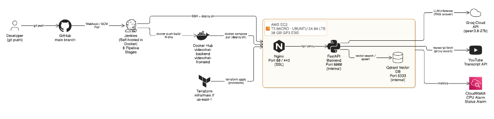

# VideoChat AI

> **Containerized, CI/CD-automated, Terraform-provisioned** YouTube Q&A platform — deployed on AWS with a full Jenkins pipeline and zero-downtime rollback.

[](https://hub.docker.com/u/pruthvirajjanwade333)
[](https://www.jenkins.io/)
[](https://www.terraform.io/)
[](https://aws.amazon.com/)
[](https://www.python.org/)
[](https://react.dev/)

---

## Architecture



---

## DevOps Highlights

- **8-stage Jenkins declarative pipeline** — Checkout → Lint (parallel Hadolint + Ruff) → pytest → Docker Build → Trivy CVE Scan → Push to Registry → Manual Approval Gate → SSH Deploy with auto-rollback
- **13 AWS resources** provisioned via Terraform in a single `terraform apply`: VPC, IGW, public subnet, route table + association, security group, IAM role + policy attachments (SSM + CloudWatch) + instance profile, EC2 `t3.micro`, and 2 CloudWatch alarms
- **Zero-downtime deployment** — `scripts/deploy.sh` polls `/api/health` for 60 s (12 x 5 s retries); auto-rollback to the previous stable image tag on any health-check failure
- **Multi-stage Docker build** for the frontend: Node 20-slim builder to nginx:1.27-alpine runtime (~25 MB final image vs ~400 MB single-stage)
- **Image tagged `build-{BUILD_NUMBER}-{GIT_SHORT_SHA}`** for full audit trail; `latest` alias also maintained on Docker Hub
- **Non-root container runtime** — backend runs as `appuser:appgroup`; FastEmbed `BAAI/bge-small-en-v1.5` model baked into the image at build time for < 2 s cold start
- **Cost-optimised Free Tier infrastructure** — public subnet (no NAT Gateway, saves ~\$32/mo), `t3.micro` with 2 GB swap via `user-data.sh`, 30 GB encrypted gp3 EBS

---

## Tech Stack

### Application

| Layer | Technology |
|---|---|
| Frontend | React 19, Vite, Tailwind CSS, Lucide React |
| Backend | FastAPI, Uvicorn, Python 3.11 |
| AI / Embeddings | FastEmbed (`BAAI/bge-small-en-v1.5`) |
| LLM | Groq Cloud API (qwen/qwen3.8-27b) |
| Vector Store | Qdrant v1.15.0 |
| Reverse Proxy | Nginx 1.27 (HTTP + HTTPS) |

### DevOps / Infrastructure

| Tool | Role |
|---|---|
| Docker & Docker Compose | Container runtime, local stack orchestration |
| Jenkins (LTS, Dockerised) | CI/CD pipeline server |
| Terraform >= 1.9 | AWS infrastructure provisioning (IaC) |
| AWS EC2 (`t3.micro`) | Compute host |
| AWS VPC + Subnets + IGW | Networking |
| AWS IAM | Instance role, SSM + CloudWatch policies |
| AWS CloudWatch | CPU and status-check alarms |
| Docker Hub | Public container image registry |
| Trivy | Container CVE scanning |
| Hadolint | Dockerfile linting |
| Ruff | Python static analysis |

### AI

| Component | Detail |
|---|---|
| Embedding model | `BAAI/bge-small-en-v1.5` via FastEmbed |
| LLM provider | Groq Cloud (serverless inference) |
| RAG pipeline | YouTube transcript -> chunk -> embed -> Qdrant -> retrieve -> Groq |
| YouTube proxy | Rotating Invidious pool bypasses AWS datacenter IP blocks |

---

## Containerization

### Services (docker-compose.yml)

| Service | Image | Ports |
|---|---|---|
| `frontend` | `pruthvirajjanwade333/videochat-frontend` | `80:80`, `443:443` |
| `backend` | `pruthvirajjanwade333/videochat-backend` | `8000` (internal) |
| `qdrant` | `qdrant/qdrant:v1.15.0` | `6333` (internal) |

### Build & Run

```bash
# 1. Clone the repository
git clone https://github.com/Pruthviraj-333/videochat-ai.git
cd videochat-ai

# 2. Create your environment file
cp .env.example .env
# Edit .env — set GROQ_API_KEY (required) and other optional overrides

# 3. Build images from source
docker compose build

# 4. Start the full stack
docker compose up -d

# 5. Verify health
curl http://localhost/api/health
```

The app is available at **http://localhost** after the stack is healthy.

### Individual Image Build

```bash
# Backend
docker build -t videochat-backend:dev ./Backend

# Frontend
docker build -t videochat-frontend:dev ./video-qa-frontend
```

### Makefile Shortcuts

```bash
make build          # docker compose build
make up             # docker compose up -d
make down           # docker compose down -v
make check          # run all linters + tests (CI quality gate)
make deploy TAG=1.0 # run scripts/deploy.sh with rollback
```

---

## CI/CD Pipeline (Jenkins)

### Pipeline Overview

The `Jenkinsfile` defines a **declarative pipeline** with an `agent any` executor, a 30-minute global timeout, and `disableConcurrentBuilds()`. Builds are parameterised so `EC2_HOST`, `DOCKERHUB_USER`, and feature toggles can be overridden per run.

### Stage-by-Stage

| # | Stage | What it does |
|---|---|---|
| 1 | **Checkout** | `checkout scm` — pulls the triggering branch; logs Git commit SHA and image tag |
| 2 | **Lint & Static Analysis** | Runs in **parallel**: Hadolint on `Backend/Dockerfile` + `video-qa-frontend/Dockerfile`; Ruff on `Backend/` Python source |
| 3 | **Unit & Integration Tests** | `pip install` deps + `pytest -v --junitxml=junit.xml Backend/tests`; JUnit XML results published to Jenkins |
| 4 | **Build Docker Images** | Builds backend and frontend images tagged `build-{BUILD_NUMBER}-{GIT_SHORT_SHA}` and `latest` |
| 5 | **Security Scan (Trivy)** | Runs `aquasec/trivy` against both images; flags `HIGH` and `CRITICAL` CVEs (skippable via `RUN_SECURITY_SCAN=false`) |
| 6 | **Push to Registry** | Authenticates with Docker Hub using the `docker-hub-credentials` credential; pushes both versioned and `latest` tags |
| 7 | **Production Approval Gate** | Interactive `input` step in Jenkins UI with 60-minute timeout; records approver identity (skippable via `REQUIRE_MANUAL_APPROVAL=false`) |
| 8 | **Deploy to Production EC2** | SCPs `docker-compose.yml` and `scripts/deploy.sh` to EC2; runs `deploy.sh {IMAGE_TAG}` via SSH with zero-downtime health-check rollback |

### Triggers

- **SCM Poll / Webhook** — configure GitHub webhook to `http://<jenkins-host>:8080/github-webhook/`
- **Manual** — trigger via Jenkins UI with optional parameter overrides

### Required Jenkins Credentials

| Credential ID | Type | Purpose |
|---|---|---|
| `docker-hub-credentials` | Username + Password (PAT) | Authenticates `docker login` and `docker push` |
| `ec2-ssh-key` | SSH Private Key (user: `ubuntu`) | SSH and SCP access to the EC2 instance |

### Required Jenkins Plugins

`Pipeline`, `SSH Agent`, `Credentials Binding`, `AnsiColor`, `Docker Pipeline`, `JUnit`

### Start Jenkins Locally

```bash
# Start Jenkins in Docker (docker-compose.jenkins.yml)
make jenkins-up

# Access Jenkins at http://localhost:8080
# View logs
make jenkins-logs

# Stop
make jenkins-down
```

---

## Infrastructure as Code (Terraform)

### Folder Layout

```
infra/
├── main.tf               # All AWS resource definitions
├── variables.tf          # Input variable declarations + defaults
├── outputs.tf            # Output values (IP, URL, SSH command, etc.)
├── versions.tf           # Required Terraform and provider versions
├── user-data.sh          # EC2 cloud-init: Docker CE install + 2 GB swap
└── terraform.tfvars.example  # Variable template (copy to terraform.tfvars)
```

### AWS Resources Provisioned (`us-east-1`)

| Resource | Details |
|---|---|
| `aws_vpc` | `10.0.0.0/16`, DNS support + hostnames enabled |
| `aws_internet_gateway` | Attached to the VPC |
| `aws_subnet` (public) | `10.0.1.0/24`, `us-east-1a`, auto-assign public IP |
| `aws_route_table` | Default route `0.0.0.0/0` to IGW |
| `aws_route_table_association` | Associates public subnet with route table |
| `aws_security_group` | Inbound: port 80 (public), port 22 (restricted to `my_ip`); egress: all |
| `aws_iam_role` | EC2 assume-role trust policy |
| `aws_iam_role_policy_attachment` x2 | `AmazonSSMManagedInstanceCore` + `CloudWatchAgentServerPolicy` |
| `aws_iam_instance_profile` | Binds IAM role to EC2 instance |
| `aws_instance` | `t3.micro`, Ubuntu 24.04 LTS, 30 GB encrypted gp3, `user-data.sh` |
| `aws_cloudwatch_metric_alarm` (CPU) | Triggers when CPU > 80% for 2 x 5-min periods |
| `aws_cloudwatch_metric_alarm` (Status) | Triggers when EC2 status check fails for 2 x 1-min periods |

### Terraform Outputs

| Output | Description |
|---|---|
| `instance_id` | EC2 instance ID |
| `instance_public_ip` | Public IPv4 address |
| `instance_public_dns` | Public DNS name |
| `app_url` | `http://<public_ip>` |
| `vpc_id` | VPC ID |
| `security_group_id` | Security Group ID |
| `ssh_command` | Ready-to-paste SSH command |

### Input Variables (`terraform.tfvars`)

```hcl
# Copy terraform.tfvars.example to terraform.tfvars
aws_region   = "us-east-1"
environment  = "production"
key_name     = "your-ec2-keypair-name"
my_ip        = "YOUR.IP.HERE/32"   # Restricts SSH port 22 to your IP
# ami_id     = ""                  # Leave empty to auto-select latest Ubuntu 24.04 LTS
```

### Commands

```bash
cd infra

# Initialise providers and backend
terraform init

# Check formatting
terraform fmt -check

# Validate configuration
terraform validate

# Dry-run — preview all changes
terraform plan

# Provision all 13 AWS resources
terraform apply

# Tear down all resources (stops billing)
terraform destroy
```

---

## Deployment on AWS

### End-to-End Flow: `git push` to Live App

```
1. Developer pushes to main branch on GitHub
2. Jenkins picks up the change (webhook or SCM poll)
3. Jenkins runs 8 pipeline stages:
   - Lints, tests, builds Docker images, scans for CVEs
   - Pushes versioned images to Docker Hub
   - Waits for manual approval in Jenkins UI
4. Jenkins SSHs into the EC2 instance
5. deploy.sh pulls new images, restarts Docker Compose services
6. deploy.sh polls /api/health every 5 s (up to 60 s)
   - HTTP 200 -> deployment finalized, old images pruned
   - Non-200 -> automatic rollback to previous stable tag
7. App is live at http://<EC2_PUBLIC_IP>
```

### Provision & Deploy from Scratch

```bash
# Step 1: Provision infrastructure
cd infra
terraform apply
# Note the app_url output: http://<EC2_PUBLIC_IP>

# Step 2: Create .env on EC2
ssh ubuntu@<EC2_PUBLIC_IP>
mkdir -p /opt/videochat
echo "GROQ_API_KEY=your_key" > /opt/videochat/.env

# Step 3: Configure Jenkins
#   - Add docker-hub-credentials (Docker Hub username + PAT)
#   - Add ec2-ssh-key (SSH private key, user: ubuntu)
#   - Set EC2_HOST parameter to the public IP from terraform output
#   - Point Jenkins to this repository

# Step 4: Trigger pipeline
#   git push origin main  — or manually trigger in Jenkins UI

# Step 5: Access the app
terraform output app_url
```

> **Note:** The infrastructure is provisioned on-demand. Run `terraform apply` to bring it up and `terraform destroy` to stop all AWS billing.

---

## Monitoring & Health

### Health Endpoint

```bash
GET /health
```

**Response (healthy):**
```json
{
  "status": "healthy",
  "qdrant": "connected",
  "embedding_model": "loaded",
  "youtube_proxy_configured": false
}
```

The endpoint is used by:
- **Docker** — `HEALTHCHECK` in `Backend/Dockerfile` polls every 30 s, 60 s start period, 3 retries
- **deploy.sh** — polls `/api/health` for 60 s post-deploy before confirming or rolling back
- **Jenkins** — stage 8 indirectly checks health via `deploy.sh` exit code

### CloudWatch Alarms

| Alarm | Condition | Action |
|---|---|---|
| `{env}-videochat-cpu-high` | CPU > 80% for 2 x 5-min periods | Alarm state (no SNS notification configured — see Future Improvements) |
| `{env}-videochat-status-check-failed` | EC2 status check fails for 2 x 1-min | Alarm state |

### Logging

Container logs are accessible via:
```bash
# On the EC2 host
docker compose logs -f backend
docker compose logs -f frontend

# Jenkins pipeline streams all stage output to build console log
```

---

## Local Development

### Prerequisites

- Docker Desktop (or Docker Engine + Compose v2)
- Python 3.11+ (for running tests without Docker)
- Node.js 20+ (for frontend dev server)
- `ruff` and `hadolint` (for linting)

### Backend (FastAPI)

```bash
cd Backend
python -m venv .venv
source .venv/bin/activate        # Windows: .venv\Scripts\activate
pip install -r requirements.txt -r requirements-dev.txt

# Start Qdrant (required by backend)
docker run -d -p 6333:6333 qdrant/qdrant:v1.15.0

# Run the API server
GROQ_API_KEY=your_key uvicorn main:app --reload --port 8000
```

### Frontend (React + Vite)

```bash
cd video-qa-frontend
npm install
npm run dev
# App available at http://localhost:5173
```

### Full Stack (Recommended)

```bash
cp .env.example .env
# Edit .env — set GROQ_API_KEY

make up              # starts all 3 services
# App at http://localhost

make test            # run pytest suite
make lint            # run Ruff + Hadolint
make check           # full CI quality gate (lint + test)
```

---

## Application Overview

VideoChat AI lets you have a conversation with any YouTube video. It extracts the transcript, chunks and embeds it into Qdrant, and answers questions using retrieval-augmented generation (RAG) via the Groq Cloud LLM API.

### Features

- **YouTube Q&A** — paste any YouTube URL and ask questions about the video content
- **Audio upload** — upload `.mp3`/`.mp4` files and ask questions about recorded audio
- **Fast retrieval** — `BAAI/bge-small-en-v1.5` embeddings pre-baked into the Docker image; < 2 s startup
- **Multi-video library** — index multiple videos and query any of them
- **Proxy-aware** — routes YouTube transcript requests through a configurable proxy to bypass cloud datacenter IP blocks

### API Endpoints

| Method | Endpoint | Description |
|---|---|---|
| `GET` | `/health` | Service health check (Qdrant + model status) |
| `POST` | `/process-video` | Index a YouTube video by URL `{"video_url": "..."}` |
| `POST` | `/process-audio` | Index an uploaded audio file (multipart: `file`, optional `video_url`) |
| `POST` | `/ask` | Ask a question about an indexed video `{"video_url": "...", "question": "..."}` |
| `GET` | `/videos` | List all indexed videos |
| `DELETE` | `/videos/{video_id}` | Remove an indexed video from Qdrant |

---

## Project Structure

```
videochat-ai/
├── Jenkinsfile                   # Declarative 8-stage CI/CD pipeline
├── Makefile                      # Unified dev/CI/Terraform shortcuts
├── docker-compose.yml            # Production stack (frontend, backend, qdrant)
├── docker-compose.jenkins.yml    # Self-hosted Jenkins server
├── .env.example                  # Environment variable template
├── .dockerignore                 # Docker build context exclusions
├── .hadolint.yaml                # Hadolint Dockerfile linter config
├── ruff.toml                     # Ruff Python linter config
├── .gitignore
│
├── Backend/                      # FastAPI application
│   ├── Dockerfile                # python:3.11-slim, non-root, model pre-baked
│   ├── main.py                   # FastAPI app + all route handlers
│   ├── requirements.txt          # Production Python dependencies
│   ├── requirements-dev.txt      # Test/dev dependencies (pytest, etc.)
│   └── tests/
│       └── test_api.py           # 10 pytest unit + integration tests
│
├── video-qa-frontend/            # React 19 + Vite frontend
│   ├── Dockerfile                # Multi-stage: node:20-slim to nginx:1.27-alpine
│   ├── nginx.conf                # HTTP/HTTPS reverse proxy config
│   ├── package.json              # React, Tailwind CSS, Vite, Lucide React
│   ├── src/
│   │   └── App.jsx               # Main application component
│   └── public/
│
├── infra/                        # Terraform Infrastructure as Code
│   ├── main.tf                   # All 13 AWS resource definitions
│   ├── variables.tf              # Input variables with defaults
│   ├── outputs.tf                # Outputs (IP, URL, SSH command)
│   ├── versions.tf               # Provider version constraints
│   ├── user-data.sh              # EC2 cloud-init (Docker + 2 GB swap)
│   └── terraform.tfvars.example  # Variable template
│
├── jenkins/
│   └── Dockerfile                # Jenkins LTS + Docker CLI (for docker-in-docker)
│
├── scripts/
│   ├── deploy.sh                 # Zero-downtime deploy + health-check rollback
│   ├── lint.sh                   # Linting runner script
│   ├── test.sh                   # Test runner script
│   └── run-checks.ps1            # Windows PowerShell quality gate
│
└── docs/
    ├── architecture.png          # System architecture diagram
    ├── INTERVIEW_NOTES.md        # 13-section architectural trade-off notes
    └── JENKINS_SETUP.md          # Step-by-step Jenkins configuration guide
```

---

## Future Improvements

> Items below are **not yet implemented** and are listed as planned enhancements only.

| Item | Description |
|---|---|
| **GitHub Actions** | Add `.github/workflows/` for PR checks and branch protection (no Actions workflows exist yet) |
| **Kubernetes (EKS/Helm)** | Replace Docker Compose on EC2 with a Kubernetes deployment for horizontal scaling |
| **Terraform Remote Backend** | Migrate local `terraform.tfstate` to S3 + DynamoDB locking for team collaboration and state locking (tfstate is currently gitignored and stored locally) |
| **SNS Notifications on CloudWatch Alarms** | Add `alarm_actions` to `aws_cloudwatch_metric_alarm` resources — alarms fire but no email/SMS notification is sent |
| **Prometheus + Grafana** | Add observability layer for request latency, error rates, and Qdrant collection metrics |
| **ECR (instead of Docker Hub)** | Move images to AWS ECR when image size is reduced below the free-tier threshold |
| **Managed TLS (ACM + ALB)** | Replace the self-signed Nginx certificate with AWS Certificate Manager + Application Load Balancer |
| **Multi-AZ / Auto Scaling** | High-availability setup across multiple availability zones |

---

## License

MIT — see [LICENSE](LICENSE) if present.

---

<p align="center">
  Built with FastAPI · React · Qdrant · Groq · Docker · Jenkins · Terraform · AWS
</p>
